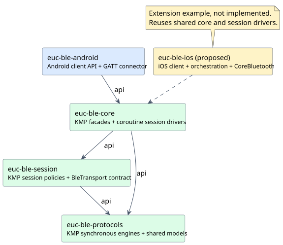
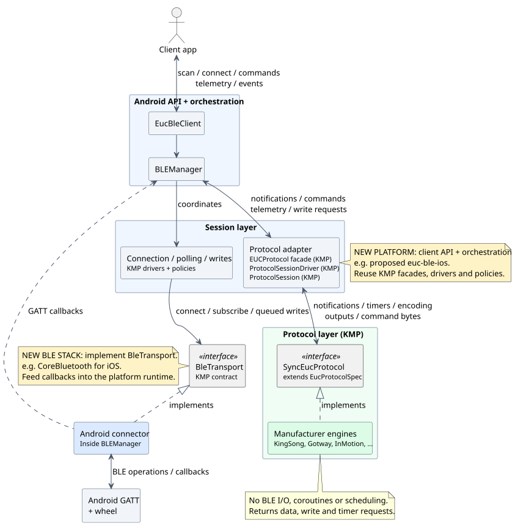

# EUC BLE Library

[](https://github.com/Tritbool/euc_ble_library/actions/workflows/ci.yml)

Bluetooth Low Energy library for electric unicycle (EUC) wheels, written in Kotlin Multiplatform.

It is **plug-and-play**: your client app connects and works with three things — **BLE devices, `EUCData` telemetry and commands**. The library handles everything else: protocol detection, frame reassembly, CRC validation, unit conversion, safe command encoding, retries, timers and security handshakes.

```kotlin
val client = EucBleClient(context)

client.setConnectionCallback(object : ConnectionCallback() {
    override fun onDeviceDiscovered(device: EUCDevice) = client.connect(device)
    override fun onConnected() { /* connected */ }
    override fun onDisconnected() { /* disconnected */ }
})
client.setDataCallback(object : DataCallback {
    override fun onDataReceived(data: EUCData) {
        // Metric telemetry: speed, voltage, current, temperature, distances, battery, BMS...
    }
})
client.setErrorCallback(object : ErrorCallback {
    override fun onError(error: BLEException) { /* handle */ }
})

client.initialize()
client.startScan()

// Commands — discovered, type-checked and state-checked before any byte is written:
client.sendCommand(CommandType.LIGHT_ON)
val descriptors = client.getCommandDescriptors()   // names, inputs, valid values
```

Callbacks run on background threads; switch to the Android main thread for UI.

**First client app:** [TuxWheel](https://github.com/Tritbool/TuxWheel) (pre-release, F-Droid planned).

## Architecture



| Module | Artifact | Role |
|---|---|---|
| `euc-ble-protocols` | `io.github.tritbool:euc-ble-protocols` | Synchronous manufacturer engines + shared models. **No BLE I/O, no coroutines.** JVM, JS, iOS, Linux and macOS targets. |
| `euc-ble-session` | `io.github.tritbool:euc-ble-session` | Coroutine-free session policies + `BleTransport` contract. |
| `euc-ble-core` | `io.github.tritbool:euc-ble-core` | KMP coroutine facades and async session drivers; re-exports protocols and session. |
| `euc-ble-android` | `io.github.tritbool:euc-ble-library` | `EucBleClient` entry point + GATT connector (`BLEManager`). |



**Sessions decide when. Protocols decide what the bytes mean. The transport does the I/O.**
A new platform reuses the whole KMP stack and only implements `BleTransport` (e.g. CoreBluetooth).
A new wheel family is a single pure state machine plus entries in the catalogue.
Details: [architecture](docs/architecture.md) — sources: [PlantUML](docs/diagrams).

## Why this library

- **Modular** — protocols, sessions, facades and connectors are separate modules with one-way
  dependencies. Engines are pure functions of notifications + time into telemetry + requests:
  they can be replayed, fuzzed and diffed without any device.
- **Reliable** — frame reassembly with CRC32 rejection and resync, split-notification handling,
  per-command validation, timeouts, bounded retries, and never fabricating readings: unknown
  fields stay `null` instead of being guessed.
- **Safe** — commands are checked against the [command contract](docs/commands/README.md) *before*
  encoding (types, ranges, choices, prerequisites). Speed-limit writes require a recent
  standstill reading. PINs and passwords are never persisted, logged or replayed; their diagnostic
  output is redacted.
- **Maintainable** — every protocol is driven by a declarative dictionary
  ([commands.json](docs/commands/commands.json)) that generates the portable descriptors; wire
  formats carry provenance comments (which capture, which firmware, which third-party codec).
- **Portable** — one Kotlin codebase targets JVM, JavaScript, iOS, Linux and macOS for protocols,
  sessions and drivers; only the GATT connector is Android-specific today.
- **Credible** — parsers are validated against raw captures recorded from real wheels
  (WheelLog dumps, per brand) and replayed in CI: genuine protocol behaviour, including
  fragmented frames and in-the-wild garbage, is locked in as regression fixtures. See
  [testing](docs/maintenance.md#testing).

## Supported wheels

| Protocol family | Wheels |
|---|---|
| Gotway / Begode | Gotway, Begode incl. ROCKET smart-BMS pages |
| ExtremeBull | Commander, HERO and siblings (Gotway-derived) |
| KingSong | Full security: PIN/password, challenge-based lock/unlock |
| InMotion | P6 / V9: model identification, dual-pack BMS, diagnostic log |
| Ninebot | Legacy + Z-series |
| LeaperKim / Veteran | Sherman family, Patton, Lynx, Oryx: tiltback/alarm writes, event log |
| Nosfet | Apex, Aero, AEON (Veteran firmware family) |

Feature availability per wheel is discoverable at runtime (`getCommandSupport`, descriptors with
`conditional` encodings, model-dependent capability lists after identification).

## Beyond telemetry

- **Smart BMS data** — per-pack current, temperatures, per-cell voltages, charge state ([guide](docs/client-guide.md#bms-data)).
- **Diagnostic logs** — verified, resumable black-box downloads (InMotion file service, LeaperKim event log) ([guide](docs/client-guide.md#inmotion-diagnostic-log)).
- **Security flows** — authentication/password/lock state exposed as flows ([guide](docs/client-guide.md#kingsong-pin-authentication-password-management-and-lock-control)).
- **Raw traffic capture** — bidirectional BLE event stream for profiling and bug reports ([guide](docs/client-guide.md#raw-ble-traffic-capture)).
- **Command contract** — one checked API across brands; no duplicated magic values in clients ([reference](docs/commands/README.md)).

## Run the quality gates

```bash
./gradlew -Peuc.includeAndroid=false :euc-ble-protocols:check
./gradlew -Peuc.includeAndroid=false :euc-ble-core:test --tests io.github.tritbool.euc.ble.AllTests
```

CI adds Android lint, coverage, SonarCloud, JVM/JS/iOS compilation and the quality dashboard:
see [maintenance & CI](docs/maintenance.md).

> **Work in progress — upcoming 1.0.0.** Protocol support is incomplete and behavior may vary by
> wheel/firmware; public APIs may evolve. Validate against your specific wheel; passing unit tests
> do not replace physical testing.

## Documentation

- [Architecture](docs/architecture.md) — modules, runtime boundaries, diagrams
- [Client guide](docs/client-guide.md) — usage details, telemetry units, security, BMS, logs, capture
- [Command contract](docs/commands/README.md) — names, inputs, permitted values, per-model variations
- [Maintenance & CI](docs/maintenance.md) — quality checks, dependency locks, test methodology
- [API reference (Dokka)](https://tritbool.github.io/euc_ble_library/api/)
- [Quality dashboard](https://tritbool.github.io/euc_ble_library/en/quality/)
- [TuxWheel](https://github.com/Tritbool/TuxWheel) — first client application
