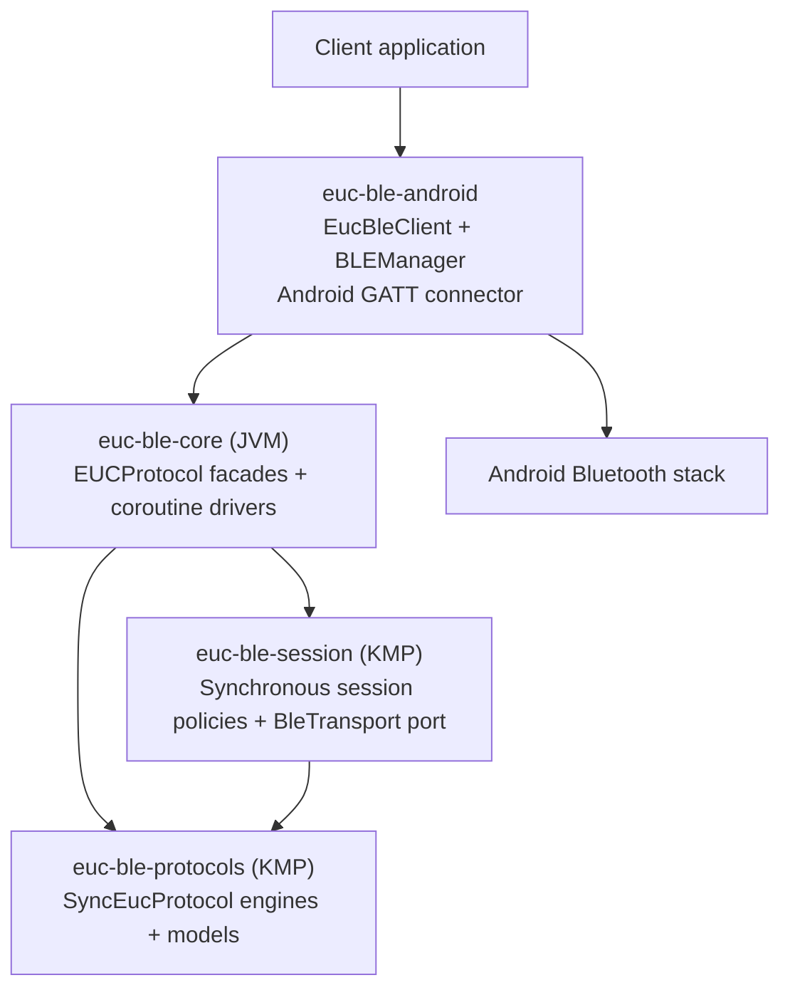
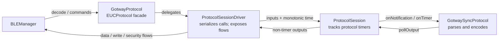

# Architecture: protocols, sessions and connectors

The library separates **what a wheel's protocol means** from **when and how BLE work is
performed**. Protocol engines are synchronous state machines. Session policies manage the
connection, polling, writes and timers. A platform connector performs BLE operations.

## Modules and dependencies

Arrows above are dependencies, not the direction of every runtime event. Both KMP modules are
coroutine-free and have JVM and JavaScript targets. Core exposes both modules and supplies JVM
clocks, randomness, flows and coroutine scheduling. Android owns GATT handles and permissions.
`BleTransport` defines the synchronous platform operations; the Android `BLEManager` implements
it, and callbacks from the stack are fed back into the drivers.

## How a protocol is adapted

Gotway is an example of the common pattern, not a special integration path. Built-in JVM
facades wrap their corresponding `SyncEucProtocol` engines with `ProtocolSessionDriver` and
present the existing `EUCProtocol` interface to Android. The driver also forwards metadata,
command encoding and other spec calls to the engine under serialization, then drains outputs.
Legacy `Any` command values are converted to `CommandValue` at the facade boundary. Some
facades retain protocol-specific compatibility behavior.

`SyncEucProtocol` extends `EucProtocolSpec`: the spec describes identification, GATT UUIDs,
supported commands, encoding and polling; the sync interface adds notification and timer
inputs and `pollOutput()`. Each engine owns its protocol-specific state and frame reassembly.
It can emit telemetry, security updates, automatic writes, timer requests and diagnostics, but
does not perform BLE I/O or schedule timers itself. Clock and randomness, where needed, are
injected. The driver serializes access because engines need not be thread-safe.

`ProtocolSession` wraps one sync engine and consumes its `StartTimer` and `CancelTimer` outputs.
It tracks deadlines using time supplied by the driver; when a deadline expires the driver calls
`advance`, which calls the engine's `onTimer`. Other outputs are delivered to the driver, which
publishes them to the facade's flows. Reset clears session timers and protocol state.

## How the session handles a wheel

There is **not one session object that owns everything**. `BLEManager` coordinates several
portable policies through their JVM drivers:

| Responsibility | Portable policy in `euc-ble-session` | JVM/Android orchestration |
|---|---|---|
| Select a protocol | `ProtocolSelector` matches protocol specs against device names and GATT snapshots. | `BLEManager` registers facades, applies the selection and enables notifications. |
| Manage connection | `ConnectionSession` and `ReconnectPolicy` decide lifecycle actions and deadlines. | `ConnectionSessionDriver` schedules deadlines and executes actions through `BleTransport`. |
| Process protocol inputs | `ProtocolSession` drains one engine and tracks its timers. | The facade's `ProtocolSessionDriver` serializes calls, schedules timers and publishes outputs. |
| Poll the wheel | `PollingEngine` tracks startup/periodic queries, responses and retries. | `PollingSession` uses the selected facade's polling plan, encoder and response matcher. |
| Send bytes | `WriteQueue` bounds and serializes writes, tracks generations and rejection/ack deadlines. | `WriteSession` runs the queue; `BLEManager` submits through `BleTransport` and supplies callbacks. |

The selected facade therefore gives the session policies a **common interface** regardless of
wheel brand. Policies do not need to understand manufacturer packet formats: they ask the
selected protocol for its plan, command bytes and response matching. Android still coordinates
selection, subscriptions, flow collection and some activation details; the portable policies
are not a complete standalone BLE runtime.

### Receiving a notification

1. Android delivers characteristic bytes to `BLEManager`. It passes them to the active
   `PollingSession` for response matching and to the selected facade's `decode`.
2. The facade/driver feeds the bytes to `ProtocolSession`, which calls the synchronous engine.
   The engine reassembles frames and queues outputs in order.
3. The session handles timer requests; the driver publishes telemetry and security outputs.
   `BLEManager` collects them for the client. An automatic `Write` output goes through the
   facade's write flow to the same write queue used for commands.

### Sending a command or polling query

1. A client command, a polling query, or a protocol-generated write reaches `BLEManager`.
   Commands and queries are encoded by the selected protocol; an automatic write already
   contains bytes.
2. `WriteSession` queues the bytes and submits them through the Android `BleTransport`.
   Queue overflow and transport failures are reported; writes are serialized.
3. Only when the BLE stack accepts a write does the manager notify the protocol via
   `onCommandSubmitted` and, for a query, notify the polling session. Protocol timers and
   query response timeouts that depend on acceptance therefore start at that point, not at
   enqueue time.
4. A GATT write callback releases the write queue; a wheel notification can separately match
   a polling response or confirm protocol-specific state. Stack acceptance or a GATT callback
   alone is not proof the wheel performed the requested operation.

On disconnect/reset, orchestration stops and protocol state, timers and queued work are reset.
Generation checks prevent stale queued work from being applied to a replacement session.
Cleanup cancels library-owned work, not the caller's coroutine scope.

## Scope and further detail

This repository remains Kotlin/KMP. A future Rust implementation belongs in a separate sister
library; no Rust bindings or crates are required here. The language-neutral
[protocol fixtures](../euc-ble-protocols/fixtures/) and
[session fixtures](../euc-ble-session/fixtures/) provide shared behavioral examples, not a
claim that every possible protocol behavior is specified.

For detailed contracts, limits, verification status and historical diagrams, see
[`euc-ble-core/ARCHITECTURE.md`](../euc-ble-core/ARCHITECTURE.md). Useful starting points in
the code are [`SyncEucProtocol`](../euc-ble-protocols/src/commonMain/kotlin/io/github/tritbool/euc/ble/protocols/SyncEucProtocol.kt),
[`ProtocolSession`](../euc-ble-session/src/commonMain/kotlin/io/github/tritbool/euc/ble/session/ProtocolSession.kt),
[`ProtocolSessionDriver`](../euc-ble-core/src/main/kotlin/io/github/tritbool/euc/ble/session/ProtocolSessionDriver.kt),
and [`BleTransport`](../euc-ble-session/src/commonMain/kotlin/io/github/tritbool/euc/ble/session/BleTransport.kt).
