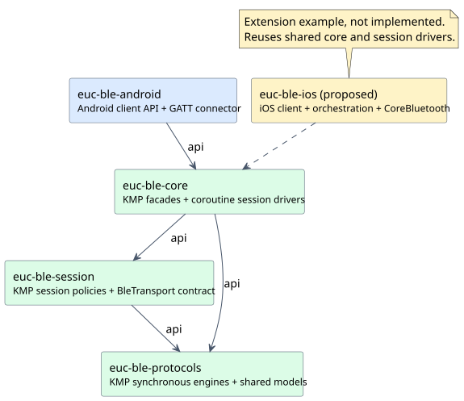
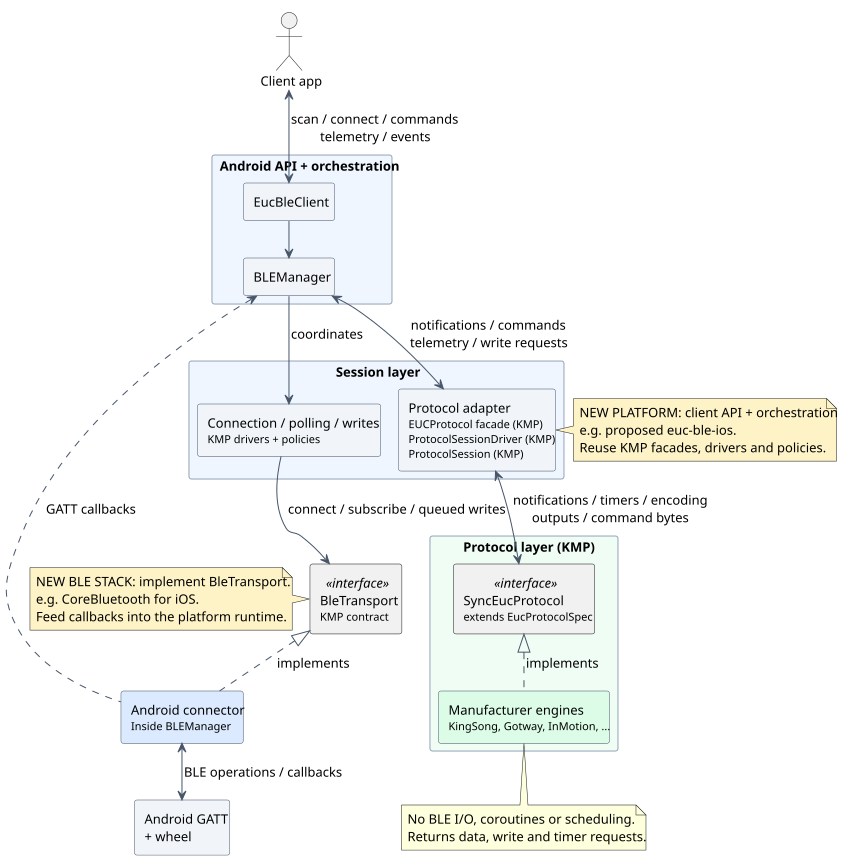

# Architecture

## Modules and dependencies



Arrows mean **depends on**. The three shared modules target JVM, JavaScript and iOS.
Protocols and session policies are synchronous and coroutine-free; core adds coroutine
drivers and facades. Gold shows proposed extensions, not existing iOS BLE support.

## Clients, sessions and protocols



**Sessions decide when; protocols decide what bytes mean; the connector performs BLE I/O.**
The session boxes are cooperating components, not a single all-in-one session object.

Notifications travel from GATT through the manager and protocol session to the engine;
decoded telemetry returns to the app through flows/callbacks. Commands travel through the
selected protocol's encoder, then the write queue and transport. Protocol-generated writes
use that same queue. A BLE write acknowledgement is not wheel-level confirmation.

## Adding iOS or another BLE stack

An `euc-ble-ios` module could provide an iOS client API, platform-specific orchestration and a
CoreBluetooth implementation of `BleTransport`. It could reuse the KMP protocol engines,
session policies, facades and coroutine drivers in `euc-ble-core`. Names such as
`EucBleClient` and `BLEManager` are optional, not extension contracts.

The shared modules already declare iOS targets, but there is no iOS connector yet.
Implementing `BleTransport` alone is not a complete client: the platform integration must
also coordinate scanning, protocol selection, subscriptions, callbacks and client events.

PlantUML sources: [modules](diagrams/modules.puml) · [runtime](diagrams/runtime.puml).
Render locally from the repository root with PlantUML (no Graphviz required):

```sh
java -jar /path/to/plantuml.jar -tsvg docs/diagrams/modules.puml docs/diagrams/runtime.puml
```

See [detailed contracts and implementation notes](https://github.com/Tritbool/euc_ble_library/blob/main/euc-ble-core/ARCHITECTURE.md)
for lower-level behavior.
