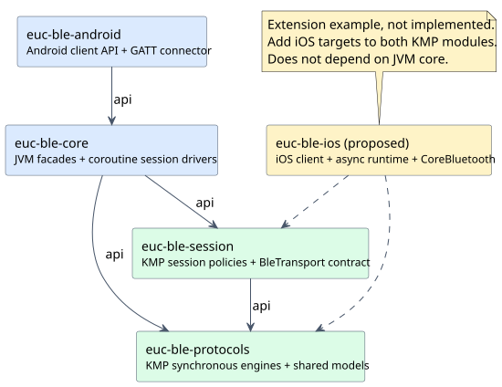
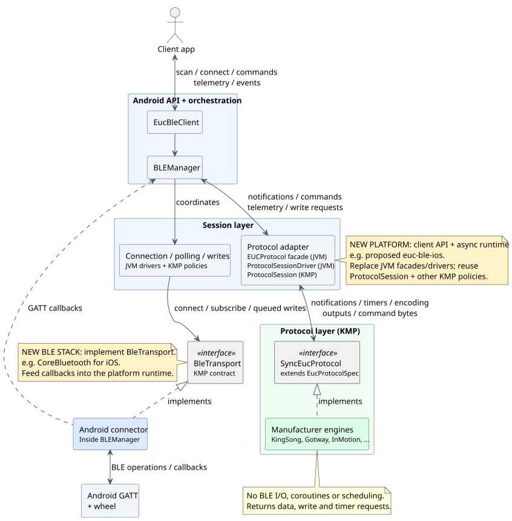

# Architecture

## Modules and dependencies



Arrows mean **depends on**. Both KMP modules are synchronous and coroutine-free.
`euc-ble-core` supplies the coroutine runtime; `euc-ble-android` supplies Android BLE.
Gold boxes and dashed dependencies show proposed extensions, not existing iOS support.

## Clients, sessions and protocols



**Sessions decide when; protocols decide what bytes mean; the connector performs BLE I/O.**
The session boxes are cooperating components, not a single all-in-one session object.

Notifications travel from GATT through the manager and protocol session to the engine;
decoded telemetry returns to the app through flows/callbacks. Commands travel through the
selected protocol's encoder, then the write queue and transport. Protocol-generated writes
use that same queue. A BLE write acknowledgement is not wheel-level confirmation.

## Adding iOS or another BLE stack

An `euc-ble-ios` module would provide an iOS client API, session orchestration and a
CoreBluetooth implementation of `BleTransport`. Reuse the synchronous engines and KMP
session policies; do not copy the protocols or depend on JVM-only `euc-ble-core`.
Names such as `EucBleClient` and `BLEManager` are optional, not extension contracts.

Today the KMP modules target JVM and JavaScript only. iOS requires adding Kotlin/Native
targets to both, supplying platform clock/random providers, scheduling deadlines and
routing BLE callbacks into the policies. Implementing `BleTransport` alone is not a
complete client runtime. Another JVM BLE stack can reuse the existing JVM drivers.

PlantUML sources: [modules](diagrams/modules.puml) · [runtime](diagrams/runtime.puml).
Render locally from the repository root with PlantUML (no Graphviz required):

```sh
java -jar /path/to/plantuml.jar -tsvg docs/diagrams/modules.puml docs/diagrams/runtime.puml
```

See [detailed contracts and implementation notes](https://github.com/Tritbool/euc_ble_library/blob/main/euc-ble-core/ARCHITECTURE.md)
for lower-level behavior.
