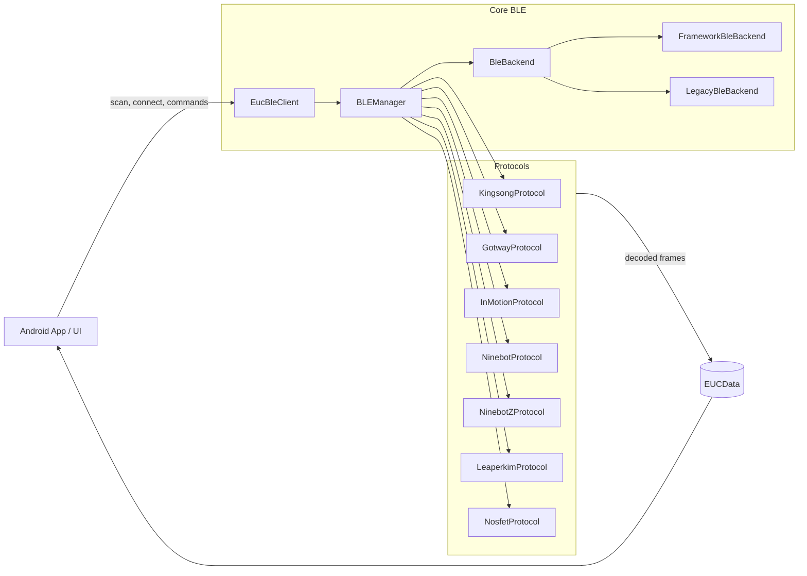

<p align="right">
  <a href="../">FR</a> | <strong>EN</strong>
</p>

# EUC BLE Library

Bluetooth Low Energy library for Electric Unicycles (EUC), providing an Android client API and manufacturer-specific protocol implementations.

> GroupId: `io.github.tritbool`  
> ArtifactId: `euc-ble-library`  
> Module: `euc-ble-core`<br>
> Current development version: `0.1.0`

> **Work in progress.** Version 0.1.0 is experimental, not a stability guarantee. Protocol support is
> incomplete; some features may be broken, vary by wheel or firmware, or change as the project evolves.
> Verify behavior on the exact device and firmware you plan to use. Unit tests and captured traffic do
> not replace physical-device testing.

---

## Why this library?

The project provides:

- A single Android entry point, `EucBleClient`, with built-in protocol registration.
- Protocol implementations and captured-frame tests for KingSong, Gotway/Begode, InMotion,
  Ninebot (including Z-series), Leaperkim/Veteran, and Nosfet. ExtremeBull currently reuses the
  Gotway protocol implementation.
- Kotlin `Flow` and callback APIs for telemetry and connection events.
- An abstract BLE backend integration layer for incremental migration and testing.

Captured-frame tests are partial and do not imply complete model, firmware, or command coverage.

---

## Client application

[TuxWheel](https://github.com/Tritbool/TuxWheel) is the first client app built with this library.
It is available as a pre-release, with publication on F-Droid planned.

---

## Key features

- **Multi‑vendor support**  
  KingSong, Gotway/Begode, InMotion, Ninebot (standard + Z‑series), Leaperkim/Veteran, Nosfet.

- **Simple client API**  
  Single entrypoint `EucBleClient` with `ConnectionCallback`, `DataCallback`, and `ErrorCallback` on the app side.

- **Extensible BLE backend**
    - `BLEManager`: BLE core.
    - `BleBackend` + `FrameworkBleBackend` + `LegacyBleBackend` + `SwitchableBleBackend`: backend integration and migration support.

- **Rich data model**  
  `EUCData` exposes speed, voltage, current, temperature, battery level, distance, power, charging state, ride time, and more.

---

## Architecture at a glance



- The **app** only talks to `EucBleClient` or the abstract backend.
- The **BLE core** handles scan, connect, reconnect, errors, and dispatches to protocols.
- **Protocols** turn raw frames into `EUCData` and expose command support.

---

## Asynchrony & data flows

- `EucBleClient` callbacks are invoked from background contexts, never guaranteed to run on the main thread – it’s up to you to switch to `Dispatchers.Main` for UI work.
- The protocol core exposes:
    - `Flow<EUCData>` for decoded telemetry.
    - `Flow<ByteArray>` (`rawFrameFlow`) for raw frames (useful for logging / debugging).
- `client.getBMSData()` returns the latest BMS snapshot (cell voltages, temperatures, pack
  voltage/current and charging status) of wheels exposing a smart BMS, or `null` otherwise. It is a
  pull API: poll it as often as needed, the app decides what to do with it (display, logging, ...).

Example usage on the app side:

```kotlin
val client = EucBleClient(context)

client.setConnectionCallback(object : ConnectionCallback() {
    override fun onDeviceDiscovered(device: EUCDevice) {
        client.connect(device)
    }
})

client.setDataCallback(object : DataCallback {
    override fun onDataReceived(data: EUCData) {
        // process telemetry on an appropriate dispatcher
    }
})

client.setErrorCallback(object : ErrorCallback {
    override fun onError(error: BLEException) {
        // fine-grained error handling
    }
})

client.initialize()
client.startScan()
```

---

## Test coverage & quality

- [Quality dashboard]({{ '/en/quality/' | relative_url }}): tests, Android Lint,
  full/focused coverage and commit-matched SonarCloud results.
- Updated after each completed main-branch quality run, including failed checks.
  Missing or stale analysis is explicitly labelled; PR results remain in GitHub and SonarCloud.

### Coverage and limitations

- CI generates JaCoCo reports for the module and for `protocols`, `models`, and `frames`.
- The report shows exercised code paths, not correctness or compatibility across all wheels.

HTML coverage reports are published under:

- [`/test-coverage/full/`](./test-coverage/full/) – global view.
- [`/test-coverage/focused/`](./test-coverage/focused/) – protocols / models / frames only.

*(See the “Test coverage reports” section below.)*

### Test methodology

Tests include **real BLE captures** and constructed unit-test cases:

- WheelLog captures exported as CSV (`RAWWHEELLOG`) for each brand.
- Captures are replayed offline with JUnit 5; no BLE emulator is needed for unit tests.
- Brand-specific tests exercise the captured decoding paths.
- Physical-device testing is still needed, especially for device/firmware combinations and commands
  not represented in the available captures.

Additional tests cover selected command/polling contracts, frame reassembly, and emission frequency.
They do not guarantee that all telemetry fields or commands behave consistently across protocols.

---

## Test coverage reports

To make coverage visible:

- CI generates full and focused JaCoCo HTML reports.
- These reports are copied into the generated site and published via GitHub Pages:


- [https://tritbool.github.io/euc_ble_library/test-coverage/full/](https://tritbool.github.io/euc_ble_library/test-coverage/full/)
- [https://tritbool.github.io/euc_ble_library/test-coverage/focused/](https://tritbool.github.io/euc_ble_library/test-coverage/focused/)
as a “health check” for the library.

---

## Using it in an app

### Maven Central dependency (0.1.0)

```kotlin
dependencies {
    implementation("io.github.tritbool:euc-ble-library:0.1.0")
}
```

The dependency is usable from Maven Central once version 0.1.0 has been published.

### Android BLE permissions

Android BLE requires:

- `BLUETOOTH_SCAN` / `BLUETOOTH_CONNECT` permissions (and sometimes location).
- Explicit handling of Bluetooth & Location state (disabled, not granted).
- Tests on **physical devices** (no BLE support in the emulator).

The library exposes structured errors via `BLEException` and `ErrorCallback` to handle these cases.

---

## API documentation

- **Home** (this page):  
  [https://tritbool.github.io/euc_ble_library/](https://tritbool.github.io/euc_ble_library/)

- **Kotlin API reference (Dokka)**:  
  [https://tritbool.github.io/euc_ble_library/api/](https://tritbool.github.io/euc_ble_library/api/)

The Pages workflow publishes the generated Dokka reference after main-branch quality checks
complete or when run manually against a completed main-branch quality run.

---

## Current limitations and next steps

- Protocol and command coverage is partial and may vary by model and firmware.
- ExtremeBull shares Gotway decoding and has one Rocket capture in the current suite; other models
  and firmware variants need broader physical-device coverage.
- More device/firmware captures and physical-device testing are needed.
- Broader settings and diagnostics coverage remain future work.

---

## Thanks to them

- [WheelLog](https://github.com/Wheellog/Wheellog.Android)
- [eried/eucplanet](https://github.com/eried/eucplanet)

---

## Contributing

Issues, PRs, and additional WheelLog captures (new wheels, new firmwares, tricky edge cases) are all welcome.  
Repository: <https://github.com/Tritbool/euc_ble_library>.
