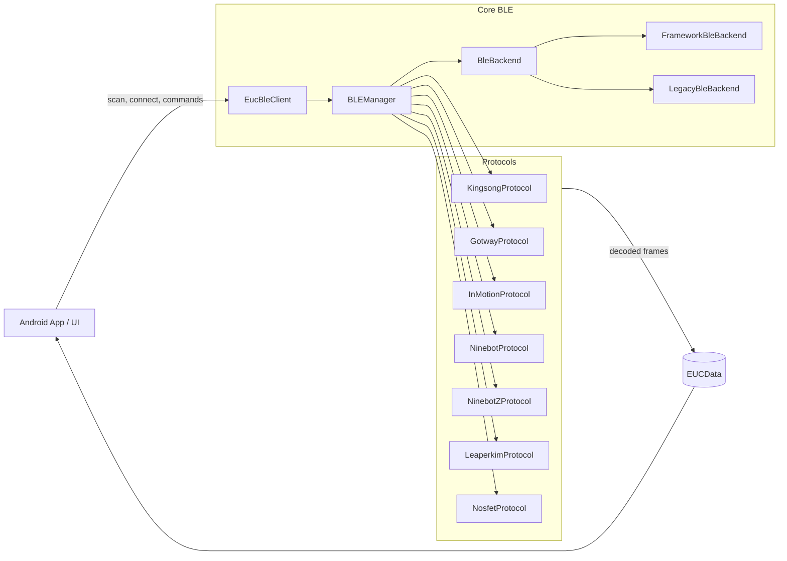

<p align="right">
  <strong>FR</strong> | <a href="./en/">EN</a>
</p>

# EUC BLE Library

Bibliothèque Bluetooth Low Energy pour monocycles électriques (EUC), avec une API client Android et des implémentations de protocoles propres aux constructeurs.

> GroupId: `io.github.tritbool`  
> ArtifactId: `euc-ble-library`  
> Module: `euc-ble-core`<br>
> Version de développement actuelle : `0.1.0`

> **Projet en cours de développement.** La version 0.1.0 est expérimentale et ne garantit pas la
> stabilité. La prise en charge des protocoles est incomplète ; certaines fonctions peuvent être
> défaillantes, varier selon la roue ou le firmware, ou évoluer avec le projet. Vérifiez le
> comportement avec l'appareil et le firmware visés. Les tests unitaires et captures ne remplacent
> pas les essais sur appareil physique.

---

## Pourquoi cette librairie ?

Le projet propose :

- Une entrée Android unique, `EucBleClient`, qui enregistre les protocoles intégrés.
- Des protocoles et tests sur captures pour KingSong, Gotway/Begode, InMotion, Ninebot
  (dont la série Z), Leaperkim/Veteran et Nosfet. ExtremeBull réutilise actuellement le protocole Gotway.
- Des API callbacks et Kotlin `Flow` pour la télémétrie et les événements de connexion.
- Une couche d'intégration de backend BLE abstraite, utile pour une migration progressive et les tests.

Les tests sur captures restent partiels et ne couvrent pas tous les modèles, firmwares ou commandes.

---

## Application cliente

[TuxWheel](https://github.com/Tritbool/TuxWheel) est la première application cliente développée
avec cette bibliothèque. Elle est disponible en pré-version ; sa publication sur F-Droid est prévue.

---

## Features clés

- **Prise en charge multi‑constructeurs**  
  KingSong, Gotway/Begode, InMotion, Ninebot (standard + Z‑series), Leaperkim/Veteran, Nosfet.

- **API client simple**  
  Entrée unique `EucBleClient` avec callbacks `ConnectionCallback`, `DataCallback`, `ErrorCallback` côté app.

- **Backend BLE extensible**
    - `BLEManager` : cœur BLE.
    - `BleBackend` + `FrameworkBleBackend` + `LegacyBleBackend` + `SwitchableBleBackend` : intégration et migration entre backends.

- **Modèle de données riche**  
  `EUCData` expose vitesse, tension, courant, température, niveau de batterie, distance, puissance, état de charge, temps de ride, etc.

---

## Architecture en un coup d’œil



- **App** parle uniquement à `EucBleClient` ou au backend abstrait.
- **Core BLE** gère scan, connexion, reconnection, erreurs et dispatch vers les protocoles.
- **Protocoles** convertissent des trames brutes en `EUCData` et exposent les commandes supportées.

---

## Asynchronicité & Flux de données

- Les callbacks de `EucBleClient` sont invoqués depuis des contextes de fond, jamais garantis sur le main thread – à toi de `Dispatchers.Main` pour l’UI.
- Le cœur protocole expose :
    - `Flow<EUCData>` pour la télémétrie décodée.
    - `Flow<ByteArray>` (`rawFrameFlow`) pour les trames brutes (utile pour logger / debug).
- `client.getBMSData()` renvoie le dernier instantané BMS (tensions de cellules, températures,
  tension/courant du pack et statut de charge) des roues dotées d'un BMS intelligent, sinon `null`.
  C'est une API pull : à interroger aussi souvent que nécessaire, l'app décide de l'usage
  (affichage, logs, ...).

Exemple d’utilisation côté app :

```kotlin
val client = EucBleClient(context)

client.setConnectionCallback(object : ConnectionCallback() {
    override fun onDeviceDiscovered(device: EUCDevice) {
        client.connect(device)
    }
})

client.setDataCallback(object : DataCallback {
    override fun onDataReceived(data: EUCData) {
        // traiter la télémétrie sur un dispatcher adapté
    }
})

client.setErrorCallback(object : ErrorCallback {
    override fun onError(error: BLEException) {
        // gestion fine des erreurs
    }
})

client.initialize()
client.startScan()
```

---

## Couverture de tests & qualité

- [Tableau de qualité]({{ '/quality/' | relative_url }}) : tests, Android Lint,
  couverture globale/ciblée et résultats SonarCloud associés au commit.
- Actualisé après chaque analyse terminée de `main`, même en cas d'échec.
  Les résultats absents ou périmés sont signalés ; ceux des PR restent dans GitHub et SonarCloud.

### Couverture et limites

- La CI génère des rapports JaCoCo pour le module et pour `protocols`, `models` et `frames`.
- Ces rapports indiquent les chemins exécutés, pas la justesse ou la compatibilité avec toutes les roues.

Les rapports HTML de couverture sont publiés sous :

- [`/test-coverage/full/`](./test-coverage/full/) – vue globale.
- [`/test-coverage/focused/`](./test-coverage/focused/) – uniquement protocole / modèles / frames.

*(Voir plus bas la section « Rapports de couverture des tests ».)*

### Méthode de test

Les tests combinent de **vraies captures BLE** et des cas unitaires construits :

- Captures WheelLog exportées en CSV (`RAWWHEELLOG`) pour chaque marque.
- Rejouées hors ligne avec JUnit 5 ; aucun émulateur BLE n'est nécessaire pour les tests unitaires.
- Tests par marque pour les chemins de décodage présents dans les captures.
- Des essais sur appareils physiques restent nécessaires, en particulier pour les combinaisons
  roue/firmware et commandes absentes des captures disponibles.

D'autres tests couvrent certains contrats de commandes et de polling, le réassemblage de trames
et la fréquence d'émission. Ils ne garantissent pas une cohérence parfaite de tous les champs ou
commandes entre protocoles.

---

## Rapports de couverture des tests

- La CI génère des rapports JaCoCo HTML complets et ciblés.
- Ces rapports sont publiés via GitHub Pages :


- [https://tritbool.github.io/euc_ble_library/test-coverage/full/](https://tritbool.github.io/euc_ble_library/test-coverage/full/)
- [https://tritbool.github.io/euc_ble_library/test-coverage/focused/](https://tritbool.github.io/euc_ble_library/test-coverage/focused/)

---

## Intégration dans une app

### Dépendance Maven Central (0.1.0)

```kotlin
dependencies {
    implementation("io.github.tritbool:euc-ble-library:0.1.0")
}
```

La dépendance sera disponible depuis Maven Central après la publication de la version 0.1.0.

### Permissions & BLE Android

Le BLE Android impose :

- Permissions `BLUETOOTH_SCAN` / `BLUETOOTH_CONNECT` (et parfois localisation).
- Gestion explicite de l’état Bluetooth & Location (désactivé, non accordé).
- Tests sur **appareils physiques** (pas d’émulateur BLE).

La lib expose des erreurs structurées via `BLEException` et `ErrorCallback` pour couvrir ces cas.

---

## Documentation API

- **Accueil** (cette page) :
  [https://tritbool.github.io/euc_ble_library/](https://tritbool.github.io/euc_ble_library/)

- **Référence API Kotlin (Dokka)** :  
  [https://tritbool.github.io/euc_ble_library/api/](https://tritbool.github.io/euc_ble_library/api/)

Le workflow Pages publie la référence Dokka générée après les contrôles de qualité de `main`,
ou manuellement à partir d'une analyse terminée du commit actuel de `main`.

---

## Limites actuelles et prochaines étapes

- La prise en charge des protocoles et commandes est partielle et peut varier selon le modèle et le firmware.
- ExtremeBull utilise le décodage Gotway et dispose d'une capture Rocket dans la suite ; d'autres
  modèles et firmwares nécessitent davantage de tests sur appareils physiques.
- Davantage de captures et de tests sur appareils physiques sont nécessaires.
- Une couverture plus large des réglages et diagnostics reste à faire.

---

## Merci à eux

- [WheelLog](https://github.com/Wheellog/Wheellog.Android)
- [eried/eucplanet](https://github.com/eried/eucplanet)

## Contribuer (pour ceux qui viendront après)

Toute issue, PR ou capture WheelLog supplémentaire (nouvelle roue, nouveau firmware, edge case) est la bienvenue.  
Voir le dépôt : <https://github.com/Tritbool/euc_ble_library>.
